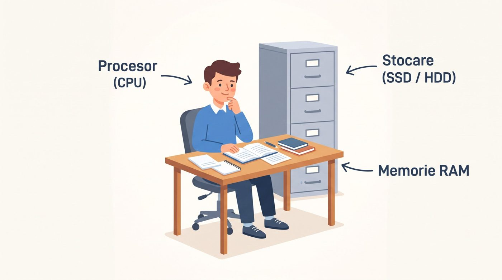
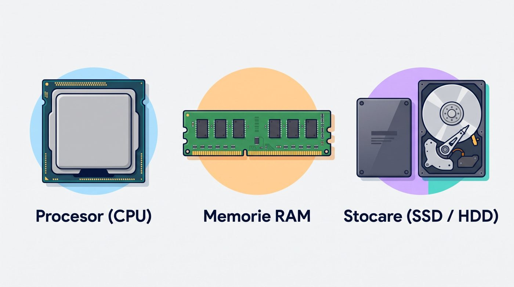
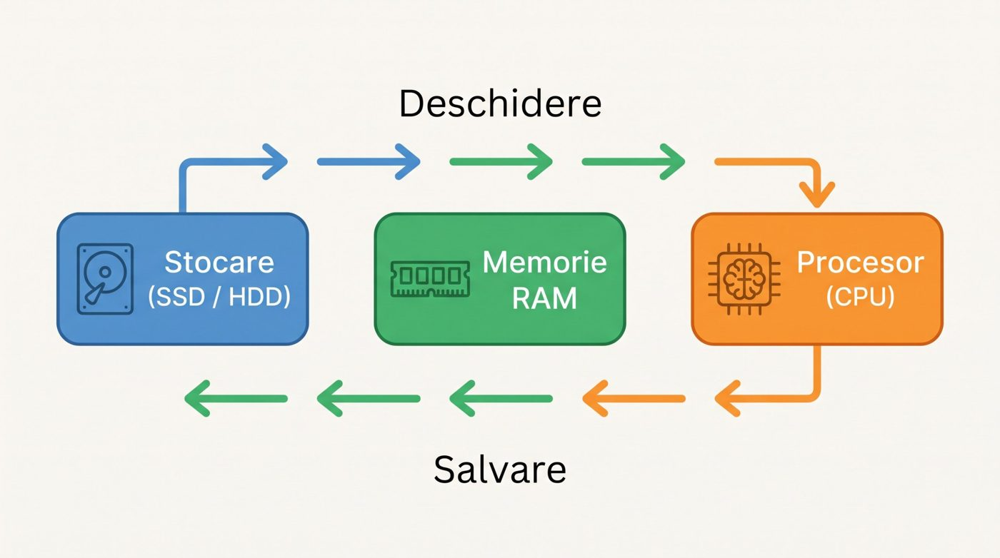

Un calculator pare complicat, dar la bază are trei părți care fac aproape tot. Azi le înveți pe rând, cu exemple simple. La final îți verifici singur ce ai înțeles.

**Ce vei învăța:**

- ce face procesorul
- ce face memoria RAM
- ce face stocarea
- cum lucrează toate trei când deschizi un document

## Analogia

Imaginează-ți că îți faci tema la un birou.

- **Tu** citești, gândești și scrii. Ești procesorul.
- **Masa** are loc doar pentru câteva caiete deschise. E memoria RAM.
- **Dulapul** păstrează toate caietele, chiar și când pleci. E stocarea.

Dacă masa e mică, te ridici des la dulap și lucrezi mai greu. La fel se întâmplă și într-un calculator.

## Definiția tehnică

**Procesorul (CPU)** este partea care execută instrucțiunile și face calculele. CPU vine de la *Central Processing Unit*, adică „unitatea centrală de procesare”. Cu cât este mai rapid, cu atât termină mai repede ce îi ceri.

**Memoria RAM** păstrează programele deschise și datele de care ai nevoie chiar acum. Procesorul ajunge la ele foarte repede. RAM este **volatilă**: când oprești calculatorul, tot ce era în ea dispare.

**Stocarea** păstrează fișierele pe termen lung: sistemul de operare, programele, pozele, documentele. Este **non-volatilă**: datele rămân și când calculatorul e oprit. Stocarea poate fi de două feluri:

- **HDD** (*hard disk*): are discuri care se rotesc. Este mai lent.
- **SSD**: are cipuri, fără piese în mișcare. Este mult mai rapid.

> [!NOTE]
> **Ține minte:** procesorul *lucrează*, RAM *ține ce folosești acum*, stocarea *păstrează tot, pe termen lung*.

## Exemplu pas cu pas

Vezi ce se întâmplă când deschizi un document, scrii în el și îl salvezi:

1. Dai dublu clic pe document.
2. Programul de scris și documentul sunt copiate din stocare în RAM.
3. Procesorul citește din RAM și afișează documentul pe ecran.
4. Scrii câteva rânduri. Ele apar doar în RAM, nu și pe stocare.
5. Apeși **Salvează**. Versiunea nouă este copiată din RAM înapoi pe stocare.
6. Închizi programul. RAM se eliberează, iar documentul rămâne în siguranță pe stocare.

> [!TIP]
> De asta pierzi ce ai scris dacă se ia curentul înainte să salvezi. Modificările erau doar în RAM.

## Unde greșesc toți

- **„Nu mai am memorie.”** Poate fi vorba de două lucruri diferite. Dacă nu mai ai loc pentru poze și filme, ți s-a umplut *stocarea*. Dacă telefonul se blochează cu multe aplicații deschise, ți s-a umplut *RAM*.
- **„Mai mult RAM înseamnă mereu un calculator mai rapid.”** Nu neapărat. Dacă masa e destul de mare pentru ce faci, una și mai mare nu te ajută. Pentru calcule grele contează procesorul. Pentru pornirea rapidă a programelor contează un SSD în loc de HDD.
- **„Tot ce fac dispare când opresc calculatorul.”** Nu. Ce ai salvat rămâne pe stocare. Se pierde doar ce era în RAM și nu ai salvat.

## Verifică-te

Alege un răspuns în minte, apoi apasă pe întrebare ca să vezi răspunsul corect.

1. Scrii un eseu pe calculator de o oră fără să fi apăsat butonul de salvare, iar curentul electric se oprește brusc. De unde s-au pierdut modificările tale?

- **A.** Din memoria RAM
- **B.** Din procesorul central
- **C.** Din memoria de stocare
- **D.** Din sistemul de operare

**Răspuns corect: A.** Memoria RAM este volatilă și păstrează temporar modificările curente, astfel că întregul ei conținut dispare la întreruperea curentului.

2. În analogia biroului din lecție, elevul ia caietele din dulap și le pune pe masă ca să lucreze. Ce componentă a calculatorului corespunde mesei?

- **A.** Procesorul (CPU)
- **B.** Discul magnetic (HDD)
- **C.** Unitatea de stocare (SSD)
- **D.** Memoria RAM

**Răspuns corect: D.** Masa este spațiul rapid unde ții la îndemână doar ce folosești acum. Exact asta face memoria RAM. Elevul este procesorul, iar dulapul este stocarea.

3. Dai dublu clic pe o fotografie salvată în calculator pentru a o vizualiza pe ecran. Care este primul traseu pe care îl parcurg datele fișierului?

- **A.** Din stocare în memoria RAM
- **B.** Din procesor în stocare
- **C.** Din memoria RAM în stocare
- **D.** Din procesor în memoria RAM

**Răspuns corect: A.** Pentru a putea fi accesat rapid de procesor, fișierul aflat pe termen lung pe SSD sau HDD este copiat mai întâi în memoria RAM.

4. Un prieten încearcă să copieze pozele din vacanță pe laptop, dar primește mesajul că nu mai are spațiu disponibil. El crede că trebuie să cumpere mai multă memorie RAM. Ce componentă trebuie să extindă sau să elibereze, de fapt?

- **A.** Procesorul (CPU)
- **B.** Stocarea (SSD sau HDD)
- **C.** Memoria volatilă
- **D.** Memoria RAM

**Răspuns corect: B.** Pozele, filmele și documentele păstrate pe termen lung ocupă spațiu pe unitatea de stocare non-volatilă.

5. Vrei un calculator care pornește sistemul de operare și aplicațiile cât mai repede, fără piese mecanice în mișcare. Ce tip de stocare ar trebui să aibă?

- **A.** O unitate electronică SSD
- **B.** O memorie volatilă RAM
- **C.** Un disc magnetic HDD
- **D.** Un procesor central CPU

**Răspuns corect: A.** SSD-ul stochează datele pe cipuri electronice, fără piese în mișcare, și oferă viteze mult mai mari de citire și de pornire.

6. Ai terminat de scris o scrisoare și apeși butonul de salvare. Ce coordonează procesorul în acel moment?

- **A.** Scrie versiunea actualizată din RAM pe stocare
- **B.** Transferă fișierul definitiv în interiorul procesorului
- **C.** Șterge fișierul vechi din memoria RAM
- **D.** Copiază fișierul din stocare în memoria RAM

**Răspuns corect: A.** La salvare, procesorul trimite modificările aflate temporar în RAM către SSD sau HDD și suprascrie vechiul fișier.

7. După ce ai salvat un document important, închizi programul de editare, dar lași calculatorul pornit. Ce se întâmplă cu datele documentului?

- **A.** Rămân blocate în RAM până la oprirea calculatorului
- **B.** Se mută din stocare direct în procesor
- **C.** Se șterg definitiv atât din RAM, cât și de pe stocare
- **D.** Se eliberează din RAM și rămân pe stocare

**Răspuns corect: D.** Închiderea aplicației eliberează spațiul ocupat în RAM pentru alte programe, iar fișierul salvat rămâne în siguranță pe SSD sau HDD.

8. Un calculator are destulă memorie RAM pentru programele deschise, dar merge foarte lent la calcule matematice complexe. Care componentă limitează performanța?

- **A.** Viteza procesorului (CPU)
- **B.** Spațiul liber de pe SSD
- **C.** Capacitatea totală a memoriei RAM
- **D.** Viteza de rotație a discului HDD

**Răspuns corect: A.** Procesorul face calculele și execută instrucțiunile, deci viteza lui hotărăște ritmul acestor operații.

9. Verifici specificațiile unui laptop obișnuit și vezi două capacități: una mult mai mică și una mult mai mare. Cum se potrivesc de obicei?

- **A.** RAM de ordinul terabaiților, stocare de ordinul gigabaiților
- **B.** RAM de ordinul gigabaiților, stocare de ordinul terabaiților
- **C.** RAM de ordinul terabaiților, stocare de ordinul terabaiților
- **D.** RAM de ordinul sutelor de gigabaiți, stocare de ordinul gigabaiților

**Răspuns corect: B.** RAM are de obicei capacități de ordinul gigabaiților, iar stocarea are sute de gigabaiți sau terabaiți.

10. Ai deschis zeci de file în browser și mai multe programe deodată, iar calculatorul încetinește brusc, deși nu faci calcule grele. În analogia biroului, ce situație descrie cel mai bine problema?

- **A.** Elevul de la birou a plecat acasă
- **B.** Dosarele din dulap au fost șterse
- **C.** Dulapul cu dosare este complet gol
- **D.** Masa de lucru a rămas fără spațiu

**Răspuns corect: D.** Când prea multe programe umplu memoria RAM, sistemul mută des date către și dinspre stocare, iar asta încetinește vizibil lucrul.

## Misiunea zilei

### Încălzire

Potrivește cele trei părți ale calculatorului cu o bucătărie: bucătarul, blatul de lucru și frigiderul. Care este care și de ce?

### Aplicare

Deschide setările calculatorului sau ale telefonului, la informații despre dispozitiv. Notează câtă **memorie RAM** are și câtă **stocare**. Care număr e mai mare?

### Provocare

Ai deschis foarte multe file în browser și calculatorul se mișcă greu. Ce crezi că se întâmplă între RAM și stocare? Indiciu: ce faci tu la birou când masa s-a umplut, dar mai ai de lucru?

**Ce urmează:** în Ziua 2 afli cum ține un calculator orice text, poză sau sunet doar cu zero și unu.
